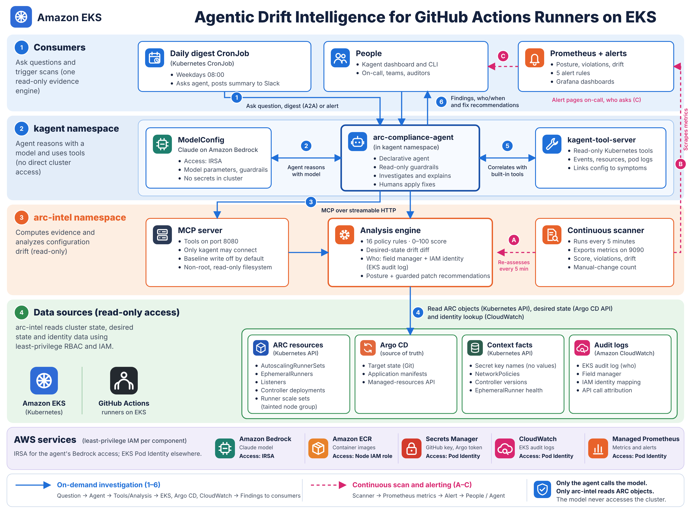

# ARC Configuration Compliance & Drift Intelligence (Kagent)

A Kagent agent that continuously governs **GitHub Actions Runner Controller (ARC)** runner scale sets:
it audits each `AutoscalingRunnerSet` against a policy pack, detects drift from the source of truth
(Helm release, GitOps, or an approved baseline), attributes every drifted field to **who changed it and
when**, and proposes owner-routed, reviewable remediation. It never changes runner configuration itself.



## Why "intelligence", not just a linter

Compliance and drift are combined into one **posture** per scale set, which tells you *where* the fix goes:

| Posture | Meaning | Where to fix |
|---|---|---|
| `healthy` | Compliant and matches its source of truth | — |
| `drifted` | Compliant, but someone changed live state | Revert, or upstream the change to Git |
| `non_compliant` | The source of truth itself breaks policy | Owning team's Helm values / Git |
| `drift_introduced_violation` | A live change *created* a violation | Incident: revert now, then investigate |
| `unknown_baseline` | No source of truth found | Put it under Helm/Argo/Flux or capture a baseline |

Every violation is tagged `origin: drift` or `origin: source_of_truth`. Every drifted field carries
`changed_by` (field manager, operation, timestamp from `metadata.managedFields`) and `manual_change: true`
when the writer isn't an expected GitOps/Helm manager, e.g. `kubectl-edit` or `kubectl-patch`.

## Policy pack (`deploy/mcp-server/policy.yaml`)

| ID | Rule | Default sev |
|---|---|---|
| ARC-001 | GitHub App auth (no PAT), config secret exists | critical |
| ARC-002 | `githubConfigUrl` within approved orgs/repos | high |
| ARC-003 | `maxRunners` set and ≤ ceiling | high |
| ARC-004 | `minRunners` ≤ max and ≤ idle budget | medium |
| ARC-005 | Images pinned (no `:latest`/untagged) | high |
| ARC-006 | Images from approved registries | high |
| ARC-007 | Runner version ≥ minimum | medium |
| ARC-008 | No privileged containers (DinD only where exempted) | critical |
| ARC-009 | No hostNetwork/PID/IPC or hostPath | high |
| ARC-010 | Runner CPU/memory requests and limits | medium |
| ARC-011 | `allowPrivilegeEscalation: false` on runner | medium |
| ARC-012 | Org/enterprise sets not in Default runner group | low |
| ARC-013 | Required ownership labels | low |
| ARC-014 | NetworkPolicy in runner namespace | medium |
| ARC-015 | Scale-set chart version matches controller | high |
| ARC-016 | Managed by Helm / Argo CD / Flux | medium |

Settings (ceilings, registries, orgs, min runner version, expected field managers) and per-namespace
`overrides` live in the same file. Any rule can be disabled or re-graded under `rules:`.
Score = 100 − (25·critical + 10·high + 5·medium + 2·low), floored at 0.

## Agent tools (MCP server)

| Tool | Purpose |
|---|---|
| `arc_inventory` | Scale sets, scope, runner group, min/max, image, mode, chart version, runner health |
| `arc_check_compliance` | Policy findings + score, filterable by severity |
| `arc_detect_drift` | Diff vs baseline › Helm release › last-applied, with field-manager attribution |
| `arc_assess` | Combined posture with violation origin |
| `arc_fleet_report` | Fleet grade, posture counts, top risks, worst-first summaries |
| `arc_controller_health` | Controller deployments and chart/controller version skew |
| `arc_propose_remediation` | Guarded RFC 6902 patch (`test` ops first) + per-rule fixes; never applied |
| `arc_capture_baseline` | Record approved state (only write; off unless `ALLOW_BASELINE_WRITE=true`) |
| `arc_list_policies` | Rule catalogue, settings, overrides, posture definitions |
| `arc_audit_trail` | EKS: every write to a scale set with Kubernetes user, IAM ARN, session, user agent |

The agent also gets read-only kagent built-ins (`k8s_get_resources`, `k8s_describe_resource`,
`k8s_get_events`, `k8s_get_pod_logs`) to correlate configuration with runner symptoms.

## Quick start

**Offline (no cluster):** runs the MCP server against a realistic 4-scale-set snapshot that covers every posture.
```bash
pip install ./mcp-server
demo/scripts/run-offline.sh
```

**On a cluster with ARC and Kagent already installed:**
```bash
docker build -t ghcr.io/my-org/arc-intel-mcp:0.1.0 mcp-server && docker push ghcr.io/my-org/arc-intel-mcp:0.1.0
# edit deploy/mcp-server/policy.yaml (orgs, registries, ceilings)
kubectl apply -k deploy/mcp-server
kubectl -n kagent create secret generic kagent-anthropic --from-literal=ANTHROPIC_API_KEY=$ANTHROPIC_API_KEY
kubectl apply -k deploy/kagent
kubectl apply -k deploy/digest          # optional weekday Slack digest
kubectl apply -f deploy/monitoring      # optional, needs Prometheus Operator
kagent invoke -n kagent --agent arc-compliance-agent --task "How compliant is our ARC fleet?"
```

**Full kind demo** (ARC + Kagent + compliant, oversized and legacy scale sets):
`demo/scripts/setup-kind.sh`, then `demo/scripts/simulate-drift.sh`, then the prompts in `demo/prompts.md`.

## Running on Amazon EKS

`demo/scripts/setup-eks.sh` builds the whole stack on EKS from `deploy/eks/`:

| Concern | Generic build | On EKS |
|---|---|---|
| Cluster | any Kubernetes | `eksctl` config: access entries (API auth mode), private managed node groups, tainted `arc-runners` group |
| LLM | Anthropic API key in a Secret | Claude on **Amazon Bedrock**, agent pod authenticated by **IRSA** (no keys) |
| Who changed it | field manager (`kubectl-edit`) | + **IAM role and session** from the EKS audit log in CloudWatch (`arc_audit_trail`, `changed_by[].actor`) |
| arc-intel AWS access | none | **EKS Pod Identity**, scoped to Logs Insights on the cluster's log group |
| GitHub App key | Kubernetes Secret | **AWS Secrets Manager** → External Secrets Operator (Pod Identity) |
| Image | any registry | **ECR**, scan on push, immutable tags |
| NetworkPolicy | CNI-dependent | **VPC CNI** with `enableNetworkPolicy` |
| Metrics | in-cluster Prometheus | + remote-write to **Amazon Managed Service for Prometheus** (SigV4, Pod Identity) |

Prerequisites: Bedrock model access for a Claude inference profile, a Secrets Manager secret `arc/github-app`,
optionally an AMP workspace. Then:
```bash
export AWS_ACCOUNT_ID=111122223333 AWS_REGION=us-west-2 CLUSTER_NAME=arc-prod \
       BEDROCK_MODEL_ID=<claude inference profile id> AMP_WORKSPACE_ID=ws-...
demo/scripts/setup-eks.sh
```
Overlays only: `deploy/eks/mcp-server` and `deploy/eks/kagent` patch the base manifests, so the generic
build keeps working. Kagent documents Bedrock with IRSA, which is why the agent uses IRSA while
everything else uses Pod Identity.

## Existing EKS cluster, adopted into Argo CD (recommended)

Follows the architecture diagram on a cluster that already runs ARC and Kagent with Helm: Argo CD adopts
the existing releases (no reinstall), becomes the source of truth, and deploys arc-intel, the agent,
External Secrets and Prometheus/Grafana. Runbook: [`clusters/README.md`](clusters/README.md).

```bash
CLUSTER_NAME=ac-ws-dev-use2 AWS_REGION=us-east-2 GITOPS_REPO=https://github.com/<org>/arc-intel.git \
  demo/scripts/adopt-existing-eks.sh discover   # then aws, generate, argocd, bootstrap, verify
```

## Existing EKS cluster without Argo CD (quick start)

`demo/scripts/setup-existing-eks.sh` adds arc-intel and the agent to a running cluster without touching
ARC, Kagent, node groups or cluster settings. It uses `deploy/existing-eks/`:
- **Source of truth:** your ARC Helm releases (no Argo CD needed).
- **Model:** reuses an existing Bedrock ModelConfig (`bedrock-native` by default), and gives the agent the same
  Bedrock access as an agent that already works (`REFERENCE_AGENT`).
- **AWS:** one ECR repo, one IAM role limited to Logs Insights on the cluster's audit log group, Pod Identity associations.

```bash
CLUSTER_NAME=ac-ws-dev-use2 AWS_REGION=us-east-2 demo/scripts/setup-existing-eks.sh
```

## GitOps with Argo CD

Target stack: **Amazon EKS + Argo CD + ARC + Kagent**. Argo CD deploys everything from this repo, and
arc-intel treats Argo CD as the source of truth for runner scale sets.

```
gitops/bootstrap/root-app.yaml      app of apps, the only manual apply
gitops/projects/projects.yaml       AppProjects: arc-platform (platform team), arc-runners (namespaced, teams)
gitops/repos/oci-helm-repos.yaml    OCI Helm repos for the ARC and Kagent charts
gitops/apps/platform.yaml           ESO, ARC controller, kube-prometheus-stack, Kagent, arc-intel, agent (sync waves)
gitops/apps/runner-scale-sets.yaml  ApplicationSet: one app per runner-scale-sets/<name>/
gitops/argocd/arc-intel-account.yaml  read-only Argo CD account for arc-intel (merge into argocd-cm / argocd-rbac-cm)
runner-scale-sets/_common/eks.yaml  shared values: GitHub App, runner group, placement, pinned image, limits
runner-scale-sets/<name>/values.yaml  one folder per runner pool, owned by a team
```

How arc-intel uses Argo CD:
- **Ownership** from the `argocd.argoproj.io/tracking-id` annotation (Argo CD 3.x default), or the instance label.
- **Desired state** from the Argo CD API `managed-resources` endpoint (the rendered Helm target), because Argo
  renders charts itself and leaves no Helm release Secret. Precedence: baseline › Argo CD › Helm › last-applied.
- **Context** from the Application CR: repo/path/revision, sync status, health, self-heal, last operation and who started it.
- **Self-healed changes:** with self-heal on, Argo reverts a `kubectl edit` within minutes. On EKS, arc-intel
  still reports it from the audit log (`out_of_band_writes`, `self_healed: true`), so the revert doesn't erase who did it.
- **Remediation** is routed to Git: `fix_in_git` names the repo and path; a revert is `argocd app sync`, never a patch.

Bootstrap on EKS: install Argo CD, merge `gitops/argocd/arc-intel-account.yaml`, generate the token into
Secrets Manager (`arc/argocd-token`), set your fork's URL in `gitops/`, then `kubectl apply -f gitops/bootstrap/`.

## Security model
- Read-only ClusterRole on ARC CRDs, Deployments, NetworkPolicies and Secrets. Secrets are read only to
  list GitHub config key *names* and to decode Helm release manifests; only the `AutoscalingRunnerSet`
  document is extracted, and any chart-rendered Secret is discarded (covered by a test).
  Tighten with per-namespace Roles + `resourceNames` if you prefer.
- The only write is the `arc-intel-baselines` ConfigMap, gated by `ALLOW_BASELINE_WRITE`, with a required reason.
- Remediation patches start with `test` ops so they fail instead of clobbering a newer change.
- The MCP server is reachable only from the `kagent` namespace (NetworkPolicy) and runs as non-root with a read-only root FS.

## Metrics & alerts
`arc_intel_compliance_score`, `arc_intel_violations{rule,severity,origin}`, `arc_intel_drift_fields{severity}`,
`arc_intel_manual_changes`, `arc_intel_posture{posture}`, `arc_intel_last_scan_timestamp_seconds`.
Alerts: drift-introduced violation (critical), critical violation, manual drift, low score, stale scanner.

## Repo layout
```
mcp-server/          Python MCP server (arc_intel/), Dockerfile, tests
deploy/mcp-server/   namespace, RBAC, Deployment/Service/NetworkPolicy, policy.yaml (kustomize)
deploy/kagent/       ModelConfig, RemoteMCPServer, Agent (with A2A skills)
deploy/digest/       CronJob that asks the agent for a digest over A2A and posts to Slack
deploy/monitoring/   ServiceMonitor + PrometheusRule
demo/                Helm values, kind setup, drift simulation, offline snapshot, prompts
```

## Development
```bash
cd mcp-server && python -m pytest          # or: python -m unittest discover -s . -p "test_*.py"
python tests/fixtures.py ../demo/offline/cluster.yaml   # regenerate the offline snapshot
```

## Verify on your versions
- Built against Kagent `kagent.dev/v1alpha2`, ARC `actions.github.com/v1alpha1` (gha-runner-scale-set), MCP Python SDK 2.x.
- Built-in tool names on `kagent-tool-server` can differ between releases: check
  `kubectl -n kagent get remotemcpserver kagent-tool-server -o yaml` (status lists discovered tools) and adjust `toolNames`.
- The `labels:` value in `demo/values/*.yaml` needs a chart version that supports it; otherwise add the
  labels with your GitOps tool.
- `claude-sonnet-5-5` in the ModelConfig is a default; any Kagent-supported provider works.
